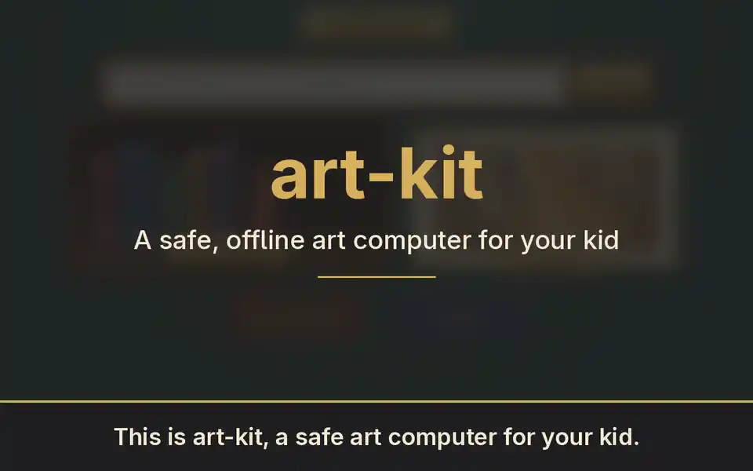

# Art Kit



This 91-second video plays on its own and repeats. It is a real test run on a 2 GB computer: your kid draws, saves, does a lesson, finds a picture, writes a note, and uses Sweet Home 3D and Blender. You can also [watch it with sound (MP4)](docs/media/art-kit-tour.mp4).

## Try it

Art Kit includes about 300 lessons, books, museum pictures and notes, plus Krita, Sweet Home 3D and Blender: one free download of about 1 GB.

| Platform | Download |
|---|---|
| Windows 10/11 | [`ArtKit-Setup-<version>.exe`](https://github.com/acetousk/art-kit/releases/latest) |
| Mac with Apple chip (M1 or newer), macOS 13 or newer | [`ArtKit-<version>-arm64.dmg`](https://github.com/acetousk/art-kit/releases/latest) |
| Mac with Intel chip, macOS 13 or newer | [`ArtKit-<version>-x64.dmg`](https://github.com/acetousk/art-kit/releases/latest) |
| Linux (x86_64) | [`ArtKit-<version>-x86_64.tar.gz`](https://github.com/acetousk/art-kit/releases/latest) |

**Windows**

1. Download the `.exe` file. Double-click it to start the installer.
2. On the blue "Windows protected your PC" screen, click **More info**.
3. Click **Run anyway**. The app is not signed.
4. Open Art Kit from the Start menu.

**Mac**

1. Download the file for your chip. To find your chip, open the Apple menu and choose **About This Mac**.
2. Open the DMG. Drag the **Art Kit** folder to **Applications**.
3. The first time, right-click (or Control-click) **Art Kit** and choose **Open**. Click **Open** again.
4. If macOS still blocks it, open **System Settings → Privacy & Security** and click **Open Anyway**.

The Art Kit launcher is not signed. Krita, Blender and Sweet Home 3D are signed by their makers.

**Linux**

1. Download the `.tar.gz` file and extract it.
2. In the extracted folder, run `./install.sh`. Do not use root. It installs to `~/.local/opt/art-kit` and adds menu entries.
3. If `install.sh` lists missing parts, install them with the command it shows.
4. Open Art Kit from the app menu.

**After install**

Art Kit downloads the books and pictures by itself and shows the progress. This is about 1.5 GB to download and 3 GB on disk. Tap **Use lessons now** to start while it downloads. If it stops, it continues at the next start.

**Updates**

Art Kit checks once a day for a new version. If one is ready, it shows a banner with a download link. It never installs by itself. To turn off the check, open Settings.

This is the try-it version for any computer. For the locked-down offline kiosk on a kid's own device, see [docs/1](docs/1-get-a-device.md).

Krita, Blender and Sweet Home 3D are free software (GPL) by their own teams. See [THIRD-PARTY.md](THIRD-PARTY.md).

Turn a cheap laptop or tablet with a pen into a safe, offline art computer for a kid. It comes with about 300 art lessons and a library of open books and museum images.

When the device turns on, the kid is in Krita. A dock at the bottom switches between **Krita · Sweet Home 3D · Blender · Library**. There is no web browser, no app store, no settings, and the kid's account has no network.

- **System:** Fedora Linux + GNOME Kiosk (free)
- **Apps:** Krita (drawing, painting, design, lettering), Sweet Home 3D (interior design), Blender Grease Pencil (3D drawing)
- **Lessons:** 7 topics, age 13 → professional level, from open sources (public domain books, CC BY, CC0, GNU FDL)
- **Backup and family view (optional):** Tresorit
- **Remote help (optional):** Tailscale + T3 Code

## Start here
| Who | Read |
|---|---|
| **Parent** | [PARENTS.md](PARENTS.md): what your kid sees and learns, safety, where the art goes, and your 10 minutes a week. No tech needed. |
| **Setup adult** | [docs/1-get-a-device.md](docs/1-get-a-device.md): which devices work, and how to test one before you pay |
| **Setup adult** | [docs/2-install-fedora.md](docs/2-install-fedora.md): install Fedora on the device |
| **Setup adult** | [docs/3-run-the-kit.md](docs/3-run-the-kit.md): edit [kit.conf](kit.conf), run [kiosk/install.sh](kiosk/install.sh), finish the manual steps |
| **Kid + parent** | [docs/4-first-day.md](docs/4-first-day.md): the first hour with the kit |
| **Setup adult + parent** | [docs/5-backup-and-share.md](docs/5-backup-and-share.md): backup, and using Tresorit to talk about the art |
| **Setup adult** | [docs/6-remote-help.md](docs/6-remote-help.md): Tailscale and T3 Code for remote help |
| **Setup adult** | [docs/7-maintenance.md](docs/7-maintenance.md): updates, reboots, upgrades, lessons |
| **Setup adult + kid** | [docs/8-when-stuck.md](docs/8-when-stuck.md): problems, checks, and fixes |
| **Lesson writers** | [lessons/RULES.md](lessons/RULES.md) and [lessons/COURSE.md](lessons/COURSE.md) |
| **Parent, teacher, or older kid** | [write-lesson skill](.claude/skills/write-lesson/SKILL.md): write your own lesson with Claude |
| **Family or teacher who forks** | [fork-kit skill](.claude/skills/fork-kit/SKILL.md): make the kit your own |
| **Everyone** | [PLAN.md](PLAN.md): the full plan, the repo layout, and what is left to build |

## What is in this repo
```
art-kit/
├── README.md       This page
├── PARENTS.md      For parents (no tech needed)
├── PLAN.md         Plan, repo layout, build steps
├── kit.conf        The only file you edit (nicknames, device name, Surface yes/no)
├── docs/           Guides for the setup adult
├── kiosk/          The install script (locked-down system + apps)
├── library/        Download lists: books, museum images
├── lessons/        Lesson rules, the course map, and one folder per lesson
└── tools/          Device check and pen test (run before you buy)
```

## Rules the kit follows
1. The kid's account has no network. Only the setup adult's account can go online (for updates and backup).
2. Only open content. Every source and license is listed.
3. No personal data in the repo. Names live only in `kit.conf` on the device.
4. The family can see everything on the device (the whole backup), and the kid knows it.
